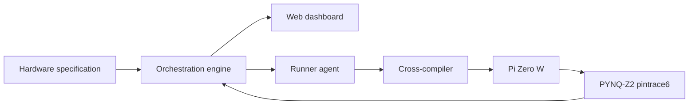

# Architecture

The platform is split into a cognitive side and a physical side. The orchestrator decides what firmware to write and how to react to a failure. The runner, the Pi, and the FPGA only build, flash, execute, and measure.

## Components

### Web dashboard

Page for the people watching a run. It shows agent reasoning, cross-compile status, generated code diffs, and timing diagrams from the FPGA trace. Week 6 is a shell that shows reasoning steps and compile logs as they happen. The interactive waveform viewer is Week 10. The dashboard stack is not chosen yet.

### Orchestration engine

Service that reads a specification, proposes firmware structure, calls a code model, and owns the retry loop. The agent framework is not chosen yet. Week 6 adds a backend that queues jobs and tracks state. The runner polls that queue. Week 8 adds the trace analyzer: fetch the FPGA trace, rebuild the timeline, and hand the agent a structured list of missing strobes, timing deltas, and races.

### Runner agent

Local daemon on the machine that can see the Pi. It takes generated source, runs the cross-compiler, flashes over UART with a CRC32 check, and starts the test. Week 8 adds a watchdog and a timeout so a hung binary cannot sit on the queue, plus a reset line that power-cycles or resets the Pi after a panic.

### Target hardware

Raspberry Pi Zero W running the test firmware bare metal. The Week 5 bootloader receives a prebuilt binary on the serial port and jumps to it in RAM. The SD card stays inserted.

### FPGA module

PYNQ-Z2 (Zynq-7000). The `pintrace6` core is a deterministic observer on the wires between the Pi and the bench: SPI, I2C, UART, PWM, and GPIO. It timestamps edges and checks them against the assertions for that run.

Week 5 capture core:

* 100 MHz timestamp counter
* Trigger on rising or falling edge
* Circular buffer in BRAM

Week 6 host path:

* AXI-Lite registers mapped into the Zynq processing system
* A host process on the PYNQ Linux image maps those registers with `/dev/mem`
* That process exposes capture status, arm, capture, and trace. The service stack is not chosen yet.

The trace path to the orchestrator is the AXI-Lite register map and this host process.

## Closed loop

Week 9 is the first time the whole path is required to heal itself.

1. A prompt asks for a bare-metal driver. Examples already in scope: BCM2835 system-timer delays, mini-UART init, interrupt setup.
2. The agent writes C.
3. The runner cross-compiles and flashes the Pi over UART.
4. The Pi toggles the milestone strobes. `pintrace6` records timestamps.
5. The analyzer compares the trace with the expected edges.
6. On a mismatch, the agent revises the source from that report and the job runs again.
7. The agent’s revised image passes on the next flash.

The stress test injects a timing bug or a wrong register bitmask into the prompt context so the first flash is expected to fail on the wires.

## Interfaces

| From | To | Contract |
| --- | --- | --- |
| Orchestrator | Runner | Job queue. The runner polls for source, builds it, and posts compile and flash results. The queue implementation is not chosen yet. |
| Runner | Pi Zero W | UART bootloader. Binary payload, CRC32, execute from RAM. |
| Runner | Pi reset | Week 8 hardware reset or power-cycle when the watchdog fires. |
| Orchestrator | PYNQ-Z2 | Capture status, arm, capture, and trace from the host process. |
| Pi GPIO | FPGA | Six milestone strobe pins plus a shared ground, landed on PMOD or Arduino headers. |
| Dashboard | Orchestrator | Live reasoning steps and compile logs. The transport is not chosen yet. |
